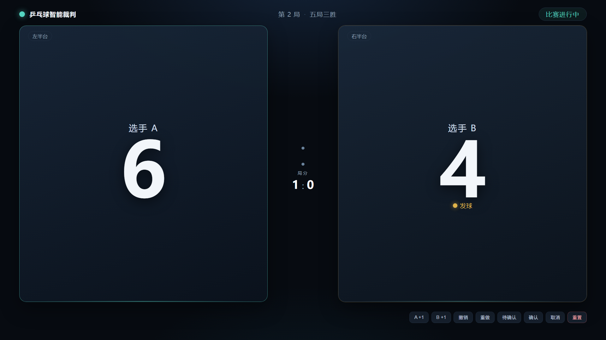
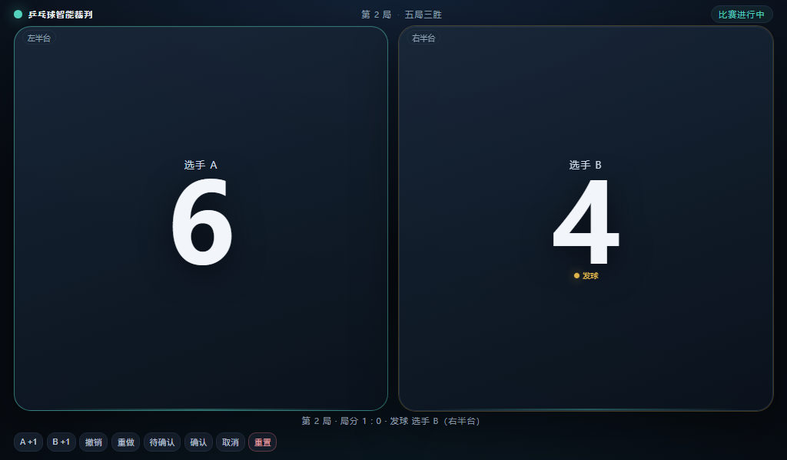
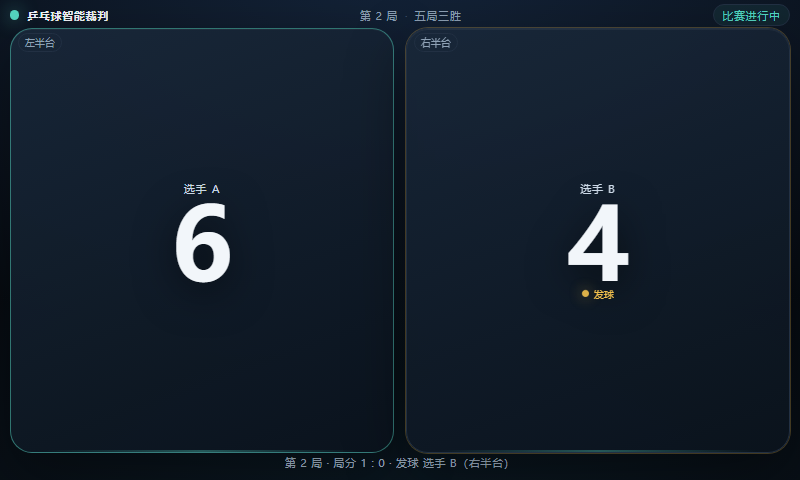
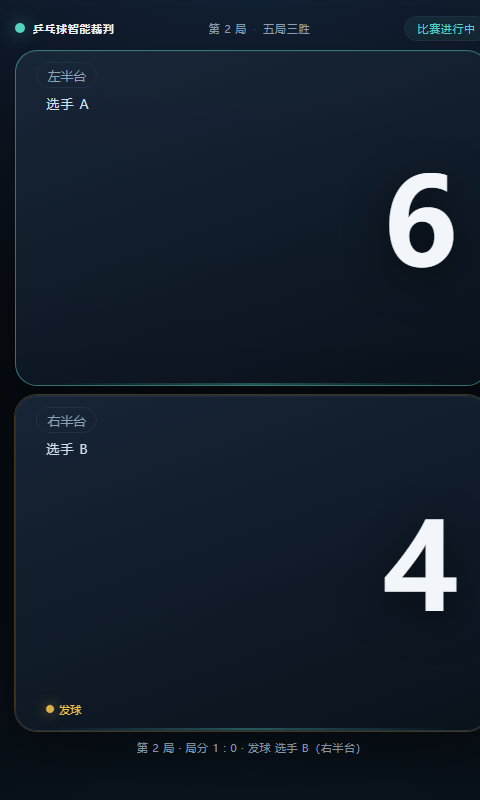

# 乒乓球智能裁判自适应计分界面

这是一个可独立运行的本地比分显示页面，用于乒乓球智能裁判项目。界面只使用
Python 标准库，不依赖 Vosk、OpenCV 或前端构建工具。

对应的离线语音识别仓库：
[xwrjym/pingpong-voice-referee](https://github.com/xwrjym/pingpong-voice-referee)。

## 功能

- 自动适配宽屏、小型横屏和竖屏，不要求全屏显示。
- 显示当前局分、盘分、发球方、局点、赛点和待人工确认状态。
- 实时模式从计分状态机只读比分，避免界面与识别线程争抢状态。
- 演示模式提供加分、撤销、重做、重置和待确认操作。
- 服务默认只监听本机 `127.0.0.1`。

## 启动

```powershell
git clone https://github.com/xwrjym/pingpong-scoreboard-ui.git
cd pingpong-scoreboard-ui
python -m tt_referee.ui
```

默认打开 `1024x600` 的无地址栏应用窗口。也可以指定常见的小屏尺寸：

```powershell
python -m tt_referee.ui --window-size 800x480
python -m tt_referee.ui --window-size 480x800
python -m tt_referee.ui --compact
```

如果不需要自动打开浏览器，只启动本地服务：

```powershell
python -m tt_referee.ui --no-browser --port 8765
```

然后访问 `http://127.0.0.1:8765/`。按 `Ctrl+C` 停止服务。

## 界面预览

### 1920 x 1080



### 1024 x 600



### 800 x 480



### 480 x 800



## 计分规则

默认采用 11 分制、领先 2 分获胜、五局三胜；发球每 2 分轮换，
10:10 后每分轮换。决胜局不自动换半场。规则可通过
`tt_referee.scoring.ScoringRules` 调整。

## 与语音仓库联动

语音识别仓库通过同一个 `ScoreEngine` 启动本 UI 的只读 HTTP 服务：

```powershell
python -m tt_voice.cli mic --ui --ui-window 1024x600 --say --verbose
```

语音进程负责写入比分，网页每 0.5 秒读取一次快照。

## 测试

```powershell
python -m unittest discover -s tests -t .
```

测试覆盖静态页面、状态接口、演示操作和只读模式。
